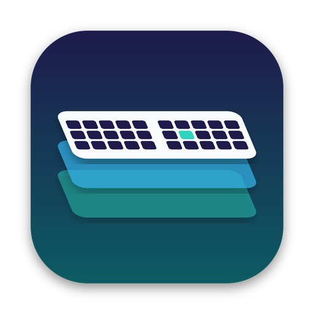

<p align="center">
  
</p>

<h1 align="center">ZMK Statbar</h1>

<p align="center">
  Your ZMK keyboard's layer, batteries and split link, in the macOS menu bar.
</p>

<p align="center">
  
  
  
</p>

ZMK Statbar shows what your keyboard is doing without you having to guess: which
layer you are on, which layers are locked on, how much battery each half has,
and whether the halves are still talking to each other. It can also keep a
floating diagram of your current layer on screen while you learn a new layout.

<!-- TODO: add a screenshot of the menu bar and panel here -->

## What it shows

**In the menu bar**

- The active layer's name, with a lock symbol when the layer is toggled on
  rather than held.
- Badges for other locked layers underneath, so an alternate alpha layer stays
  visible while you hold a function layer on top of it.
- A warning symbol when a split half has lost its link to the other half.
- Caps Lock, held modifiers (optional) and a `USB` badge when the keyboard is
  sending over USB instead of Bluetooth.
- The battery level of each half, as in ZMK Battery Bar.

**In the panel** (click the menu bar item)

- Layer, locked layers, split link, output (USB or Bluetooth profile number)
  and the firmware build, which confirms exactly which build is flashed.
- Battery details and all settings.

**Cheat sheet**

- A floating window with the keymap diagram of your current layer, following
  you as you switch layers. Uses the SVGs that
  [keymap-drawer](https://github.com/caksoylar/keymap-drawer) generates.

**Alerts**

- A notification when either half drops to a battery threshold you choose.

Battery levels and Caps Lock work with any ZMK keyboard. Everything about
layers, the split link, modifiers and output needs the small firmware module
described below.

## Requirements

- macOS 14 (Sonoma) or later
- A ZMK keyboard connected to the Mac over Bluetooth
- For layer features: the [zmk-host-status](https://github.com/johncattrall/zmk-host-status)
  module in your firmware

## Setup

### 1. Firmware

Add the module to your zmk-config's `config/west.yml`:

```yaml
manifest:
  remotes:
    - name: johncattrall
      url-base: https://github.com/johncattrall
  projects:
    - name: zmk-host-status
      remote: johncattrall
      revision: main
```

For both halves' batteries on a split, also add this to the central half's
`.conf` file (the right half on most splits):

```ini
CONFIG_ZMK_BATTERY_REPORTING=y
CONFIG_ZMK_SPLIT_BLE_CENTRAL_BATTERY_LEVEL_PROXY=y
CONFIG_ZMK_SPLIT_BLE_CENTRAL_BATTERY_LEVEL_FETCHING=y
```

Rebuild and flash the central half. Then remove the keyboard in System
Settings, Bluetooth, and pair it again. macOS caches the list of services a
keyboard offers, and the new one stays invisible until you re-pair.

### 2. App

Install with Homebrew:

```sh
brew install johncattrall/tap/zmk-statbar
```

Or download the zip from [Releases](https://github.com/johncattrall/zmk-statbar/releases)
and move **ZMK Statbar** to Applications. Both are signed and notarized by
Apple, so macOS opens them without warnings.

To build from source instead you need Xcode or the Xcode command line tools:

```sh
git clone https://github.com/johncattrall/zmk-statbar
cd zmk-statbar
./scripts/build-app.sh
cp -r "build/ZMK Statbar.app" /Applications/
```

### 3. First launch

1. Open ZMK Statbar. It appears in the menu bar; there is no Dock icon.
2. Allow Bluetooth access when macOS asks.
3. Click the menu bar item, then **Keyboards...**, then **Start Scan**, and
   pick your keyboard.

The layer name appears next to the batteries within a second or two. If only
batteries appear, see Troubleshooting.

## Settings

| Setting | Default | What it does |
|---|---|---|
| Show Layer in Menu Bar | On | Active layer name and locked-layer badges |
| Hidden layers | `Mouse` | Comma-separated layer names never shown. Stops an auto-mouse layer raised by trackball motion from making the indicator flicker |
| Show Held Modifiers | Off | Shows ⌃ ⌥ ⇧ ⌘ while held. Useful for spotting home row mod misfires |
| Keymap Diagram | Empty | The keymap-drawer SVG for the cheat sheet, see below |
| Show Caps Lock | On | Caps Lock symbol while Caps Lock is on |
| Low Battery Alerts | On, at 15% | Notification when a half drops to the threshold |
| Show Batteries in Menu Bar | On | Turn off to show only the layer. Batteries come back whenever there is no layer to show, and low battery alerts still fire |
| Hide Battery Icon, Single Line Layout, Swap Battery Positions | Off | Battery display options from ZMK Battery Bar |
| Auto-Switch to Active Keyboard | Off | Follows whichever saved keyboard you are typing on (needs Input Monitoring) |
| Launch at Login | Off | Starts the app when you log in |

### Cheat sheet

The cheat sheet uses the SVG [keymap-drawer](https://github.com/caksoylar/keymap-drawer)
draws of your whole keymap, usually `keymap-drawer/<board>.svg` in your
zmk-config. It shows only the layer you are on and follows you as you switch.

Under **Keymap Diagram** in the panel, either:

- click **Choose...** and pick the file in your local copy of your zmk-config.
  It reloads whenever the file changes, works offline and works with private
  repositories; or
- paste the file's GitHub link, for example
  `https://github.com/<you>/<zmk-config>/blob/main/keymap-drawer/<board>.svg`,
  and press Return. It downloads again whenever you open the window or flash a
  new firmware build.

Then click **Show Cheat Sheet**. The window floats above other apps and
remembers its size and position. Layers are matched by the names the keyboard
reports, which keymap-drawer uses too.

## Troubleshooting

**Only batteries appear, no layer.** The keyboard is not exposing the module's
service to macOS. Check that the central half was flashed with the module, then
remove and re-pair the keyboard so macOS refreshes its cached service list.

**The split link warning stays on while both halves work.** Make sure the
central half runs the current zmk-host-status. Early versions had a bug that
reported the link as down.

**The peripheral battery is missing.** Add the battery proxy settings from the
Firmware section to the central half's `.conf`, reflash and re-pair.

**The cheat sheet says a layer is missing.** The layer names in the SVG must
match your keymap's `display-name`s. Redraw the SVG after renaming layers.

**No low battery notification.** Allow notifications for ZMK Statbar in System
Settings, Notifications.

## How it works

The app shares the Bluetooth connection macOS already keeps open for your
keyboard; it never opens one of its own. It reads the standard Battery Service
for battery levels, and the zmk-host-status service for everything else. Both
push updates when something changes, so the app sits idle otherwise. A slow
poll catches anything a notification missed.

The zmk-host-status protocol is documented in its
[README](https://github.com/johncattrall/zmk-host-status#protocol), so other
host apps can read it too.

## Development

```sh
swift build                    # debug build
swift test                     # unit tests
./scripts/build-app.sh         # build/ZMK Statbar.app, ad-hoc signed
open "build/ZMK Statbar.app"
```

Launch the `.app` bundle rather than `swift run` when testing anything to do
with Bluetooth or the menu bar: the raw executable has no `Info.plist`, so
neither works reliably.

| Directory | Contents |
|---|---|
| `Sources/.../App/` | Entry point, AppDelegate, status item, cheat sheet window |
| `Sources/.../BLE/` | CoreBluetooth manager, battery and host status parsing |
| `Sources/.../Views/` | SwiftUI views: menu bar content, panel, keyboard list, cheat sheet |
| `Sources/.../Models/` | Battery and host status state, settings, saved keyboards |
| `Sources/.../Utilities/` | Pure helpers (layer display, diagram URLs, alert policy) and system integrations |

Logic that can be tested without Bluetooth lives in small pure helpers with
tests under `Tests/`. `AGENTS.md` describes the conventions in more detail.

### Releases

Pushing a version tag runs `.github/workflows/release.yml`, which builds, signs
and notarizes the app, attaches it to a GitHub Release and updates the cask in
[johncattrall/homebrew-tap](https://github.com/johncattrall/homebrew-tap). It
needs these repository secrets:

| Secret | Contents |
|---|---|
| `DEVELOPER_ID_CERTIFICATE_BASE64` | Developer ID Application certificate and key, exported as .p12, base64 encoded |
| `DEVELOPER_ID_CERTIFICATE_PASSWORD` | Password of that .p12 |
| `APPLE_ID` | Apple ID used for notarization |
| `APPLE_ID_PASSWORD` | App-specific password for that Apple ID |
| `APPLE_TEAM_ID` | Team ID of the developer account |
| `HOMEBREW_TAP_TOKEN` | Token with write access to the tap. Without it the cask update is skipped |

## Credits

ZMK Statbar started as a fork of [ZMK Battery Bar](https://github.com/itouuuuuuuuu/zmk-battery-bar)
by Masafumi ITO, which still does the Bluetooth and battery work underneath. If
battery levels are all you need, use the original. If this app is useful to
you, consider supporting the original author at
<https://github.com/sponsors/itouuuuuuuuu>.

Keymap diagrams come from [keymap-drawer](https://github.com/caksoylar/keymap-drawer)
by [caksoylar](https://github.com/caksoylar).

## License

MIT. See [LICENSE](LICENSE).
